

# bevy_rui

Retained UI (RUI) widget library and layout system for the **Bevy Engine**, designed for both **desktop applications / editor tools** and **9-slice textured game UIs**.

These are the included demos. For the game demos you need the [Kenney UI Assets Pack](https://kenney-assets.itch.io/ui-pack).

* Theming and textures (Ninepatch / 9-slice) are fully supported for all game-oriented widgets.
* Built-in keyboard and gamepad directional navigation (`D-Pad` + `Left Stick`).
* If you want to support the project: [ko-fi goal](https://ko-fi.com/robertxy/goal?g=1) or [ko-fi member](http://ko-fi.com/robertxy/tiers)

## Bevy Compatibility

| `bevy_rui` | `bevy` |
| :--- | :--- |
| **`0.1.8`** | **`0.20.1`** |
| `0.1.7` | `0.20.0` |
| `0.1.6` | `0.19.0` |

## Widgets

* **Accordion Menu** (`example_accordion` / `example_game_accordion`)
* **Button** (`example_button` / `example_game_button`)
* **Canvas Layer** (for multi-camera Game HUDs — `example_canvas_layer` / `example_game_canvas_layer`)
* **Checkbox** (`example_checkbox` / `example_game_checkbox`)
* **Clipboard** (`example_clipboard` / `example_game_clipboard`)
* **Color Picker** (`example_color_picker` / `example_game_color_picker`)
* **Context Menu** (`example_context_menu` / `example_game_context_menu`)
* **Debug Colors** (`example_debug_colors` / `example_game_debug_colors`)
* **Dock (Splittable Panels)** (`example_docks` / `example_game_docks`)
* **Dropdown** (`example_dropdown` / `example_game_dropdown`)
* **Label** (`example_label` / `example_game_label`)
* **Layout (`vbox` / `hbox`)** (`example_layout` / `example_game_layout`)
* **Menu & Submenu** (`example_menu` / `example_game_menu`)
* **Open/Save File Dialog** (`example_file_dialog` / `example_game_file_dialog`)
* **Progress Bar** (`example_progress_bar` / `example_game_progress_bar`)
* **Resizer (Splitter Bar)** (`example_resizer` / `example_game_resizer`)
* **ScrollView** (`example_scrollview` / `example_game_scrollview`)
* **Slider** (`example_slider` / `example_game_slider`)
* **Tabs** (`example_tabs` / `example_game_tabs`)
* **Textbox** (`example_textbox` / `example_game_textbox`)
* **Tooltip** (`example_tooltip` / `example_game_tooltip`)
* **Viewport (Camera-in-UI)** (`example_viewport` / `example_game_viewport`)
* **Windows (Draggable & Z-Ordered)** (`example_windows` / `example_game_windows`)

---

## Widget Gallery (Game 9-Slice Theme)

Each widget includes both a standard application example (`cargo run --example example_<widget>`) and a 9-slice textured game UI example (`cargo run --example example_game_<widget>`).

### Accordion
* **App Example:** [`examples/example_accordion.rs`](examples/example_accordion.rs) — `cargo run --example example_accordion`
* **Game Example:** [`examples/example_game_accordion.rs`](examples/example_game_accordion.rs) — `cargo run --example example_game_accordion`

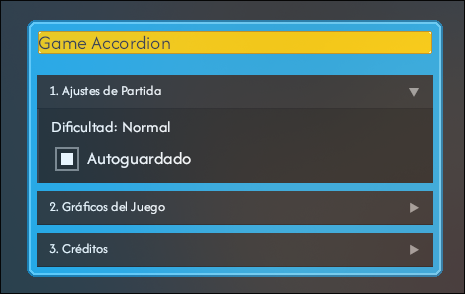

### Button
* **App Example:** [`examples/example_button.rs`](examples/example_button.rs) — `cargo run --example example_button`
* **Game Example:** [`examples/example_game_button.rs`](examples/example_game_button.rs) — `cargo run --example example_game_button`

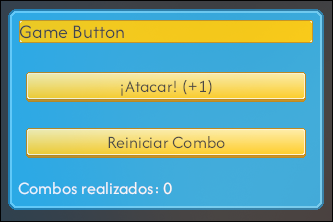

### Canvas Layer (Game HUD Overlay)
* **App Example:** [`examples/example_canvas_layer.rs`](examples/example_canvas_layer.rs) — `cargo run --example example_canvas_layer`
* **Game Example:** [`examples/example_game_canvas_layer.rs`](examples/example_game_canvas_layer.rs) — `cargo run --example example_game_canvas_layer`

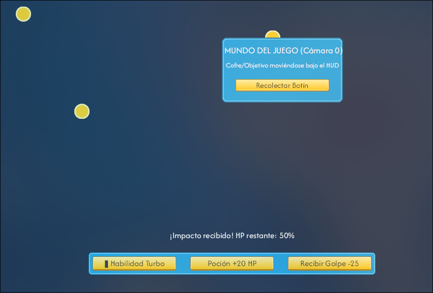

### Checkbox
* **App Example:** [`examples/example_checkbox.rs`](examples/example_checkbox.rs) — `cargo run --example example_checkbox`
* **Game Example:** [`examples/example_game_checkbox.rs`](examples/example_game_checkbox.rs) — `cargo run --example example_game_checkbox`

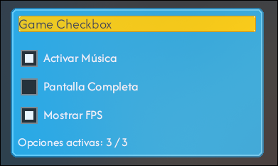

### Clipboard
* **App Example:** [`examples/example_clipboard.rs`](examples/example_clipboard.rs) — `cargo run --example example_clipboard`
* **Game Example:** [`examples/example_game_clipboard.rs`](examples/example_game_clipboard.rs) — `cargo run --example example_game_clipboard`

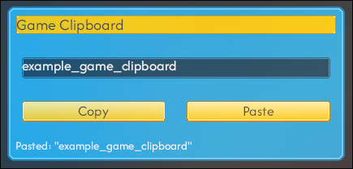

### Color Picker
* **App Example:** [`examples/example_color_picker.rs`](examples/example_color_picker.rs) — `cargo run --example example_color_picker`
* **Game Example:** [`examples/example_game_color_picker.rs`](examples/example_game_color_picker.rs) — `cargo run --example example_game_color_picker`

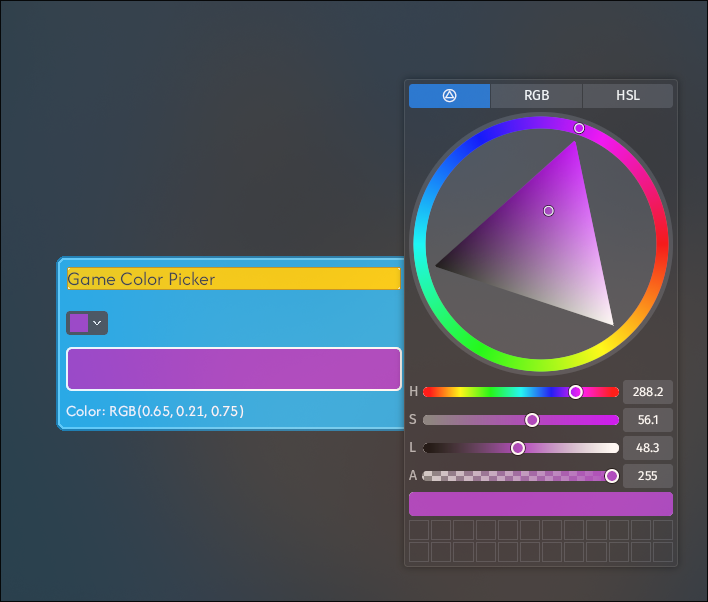

### Context Menu
* **App Example:** [`examples/example_context_menu.rs`](examples/example_context_menu.rs) — `cargo run --example example_context_menu`
* **Game Example:** [`examples/example_game_context_menu.rs`](examples/example_game_context_menu.rs) — `cargo run --example example_game_context_menu`

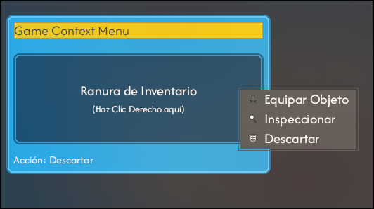

### Docks (Splittable Panels)
* **App Example:** [`examples/example_docks.rs`](examples/example_docks.rs) — `cargo run --example example_docks`
* **Game Example:** [`examples/example_game_docks.rs`](examples/example_game_docks.rs) — `cargo run --example example_game_docks`

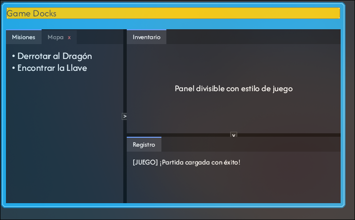

### Dropdown
* **App Example:** [`examples/example_dropdown.rs`](examples/example_dropdown.rs) — `cargo run --example example_dropdown`
* **Game Example:** [`examples/example_game_dropdown.rs`](examples/example_game_dropdown.rs) — `cargo run --example example_game_dropdown`

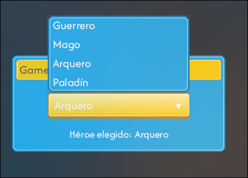

### File Dialog (Open / Save)
* **App Example:** [`examples/example_file_dialog.rs`](examples/example_file_dialog.rs) — `cargo run --example example_file_dialog`
* **Game Example:** [`examples/example_game_file_dialog.rs`](examples/example_game_file_dialog.rs) — `cargo run --example example_game_file_dialog`

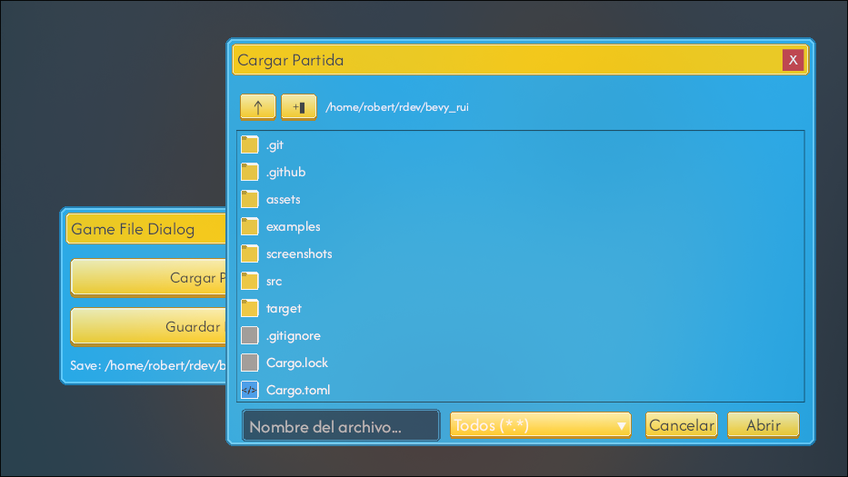

### Label
* **App Example:** [`examples/example_label.rs`](examples/example_label.rs) — `cargo run --example example_label`
* **Game Example:** [`examples/example_game_label.rs`](examples/example_game_label.rs) — `cargo run --example example_game_label`

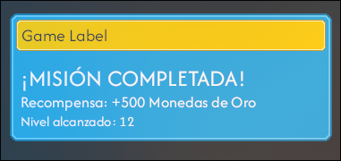

### Layout (`vbox` & `hbox`)
* **App Example:** [`examples/example_layout.rs`](examples/example_layout.rs) — `cargo run --example example_layout`
* **Game Example:** [`examples/example_game_layout.rs`](examples/example_game_layout.rs) — `cargo run --example example_game_layout`

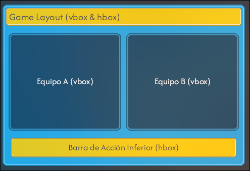

### Menu & Submenu
* **App Example:** [`examples/example_menu.rs`](examples/example_menu.rs) — `cargo run --example example_menu`
* **Game Example:** [`examples/example_game_menu.rs`](examples/example_game_menu.rs) — `cargo run --example example_game_menu`

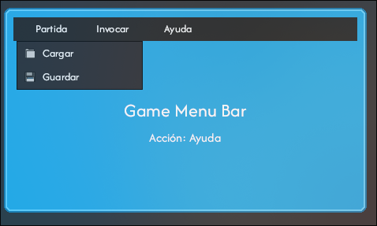

### Progress Bar
* **App Example:** [`examples/example_progress_bar.rs`](examples/example_progress_bar.rs) — `cargo run --example example_progress_bar`
* **Game Example:** [`examples/example_game_progress_bar.rs`](examples/example_game_progress_bar.rs) — `cargo run --example example_game_progress_bar`

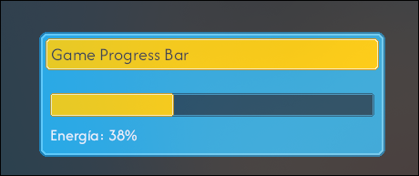

### Resizer (Splitter Bar)
* **App Example:** [`examples/example_resizer.rs`](examples/example_resizer.rs) — `cargo run --example example_resizer`
* **Game Example:** [`examples/example_game_resizer.rs`](examples/example_game_resizer.rs) — `cargo run --example example_game_resizer`

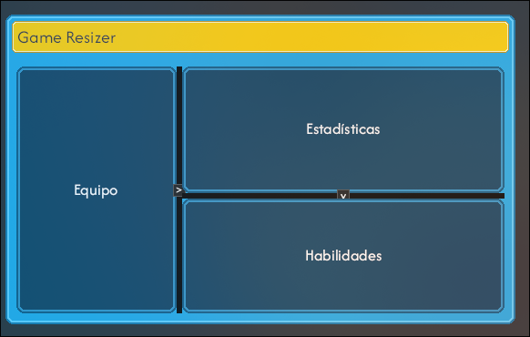

### ScrollView
* **App Example:** [`examples/example_scrollview.rs`](examples/example_scrollview.rs) — `cargo run --example example_scrollview`
* **Game Example:** [`examples/example_game_scrollview.rs`](examples/example_game_scrollview.rs) — `cargo run --example example_game_scrollview`

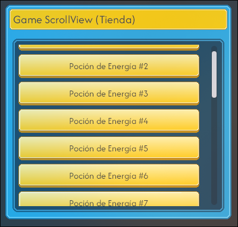

### Slider
* **App Example:** [`examples/example_slider.rs`](examples/example_slider.rs) — `cargo run --example example_slider`
* **Game Example:** [`examples/example_game_slider.rs`](examples/example_game_slider.rs) — `cargo run --example example_game_slider`

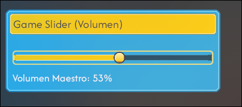

### Tabs
* **App Example:** [`examples/example_tabs.rs`](examples/example_tabs.rs) — `cargo run --example example_tabs`
* **Game Example:** [`examples/example_game_tabs.rs`](examples/example_game_tabs.rs) — `cargo run --example example_game_tabs`

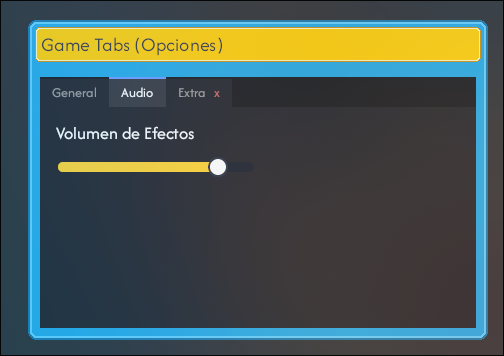

### Textbox
* **App Example:** [`examples/example_textbox.rs`](examples/example_textbox.rs) — `cargo run --example example_textbox`
* **Game Example:** [`examples/example_game_textbox.rs`](examples/example_game_textbox.rs) — `cargo run --example example_game_textbox`

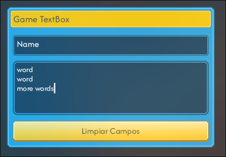

### Tooltip
* **App Example:** [`examples/example_tooltip.rs`](examples/example_tooltip.rs) — `cargo run --example example_tooltip`
* **Game Example:** [`examples/example_game_tooltip.rs`](examples/example_game_tooltip.rs) — `cargo run --example example_game_tooltip`

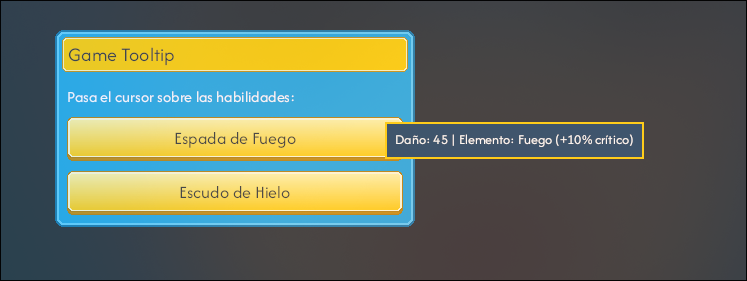

### Viewport (Camera-in-UI)
* **App Example:** [`examples/example_viewport.rs`](examples/example_viewport.rs) — `cargo run --example example_viewport`
* **Game Example:** [`examples/example_game_viewport.rs`](examples/example_game_viewport.rs) — `cargo run --example example_game_viewport`

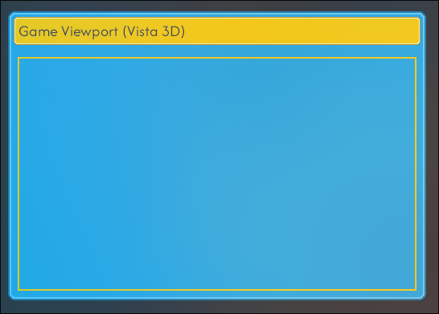

### Windows
* **App Example:** [`examples/example_windows.rs`](examples/example_windows.rs) — `cargo run --example example_windows`
* **Game Example:** [`examples/example_game_windows.rs`](examples/example_game_windows.rs) — `cargo run --example example_game_windows`

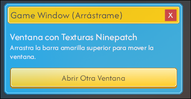

---

## Full Showcase Demos

[dock demo](https://github.com/prfiredragon/bevy_rui/blob/main/examples/layout_dock.rs)

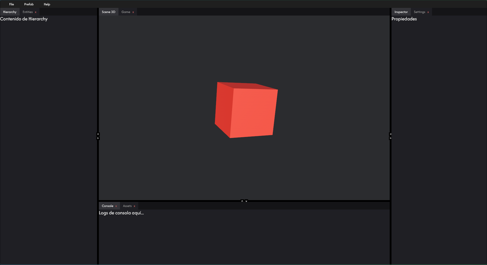

[Layout dock save](https://github.com/prfiredragon/bevy_rui/blob/main/examples/layout_dock_save.rs)

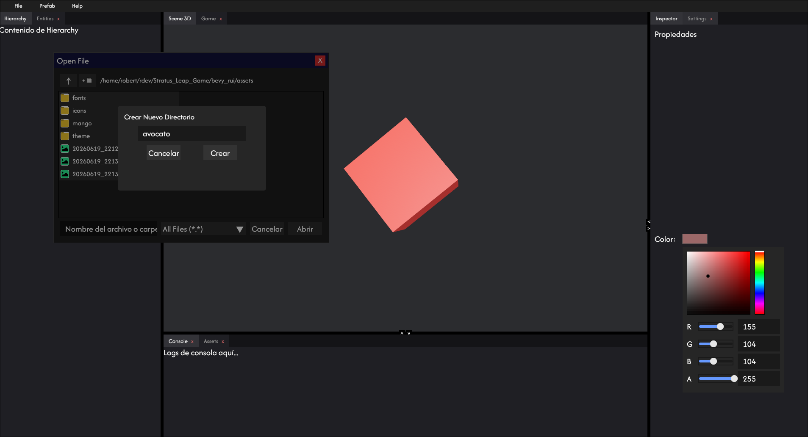

[layout demo](https://github.com/prfiredragon/bevy_rui/blob/main/examples/layout_test.rs)

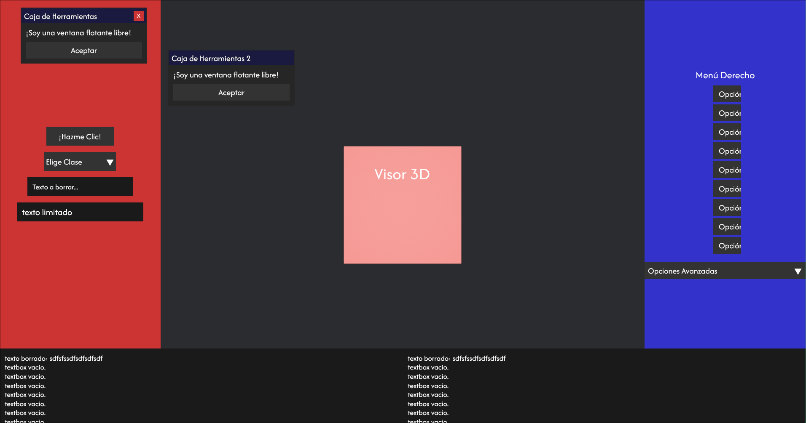

[game menu demo](https://github.com/prfiredragon/bevy_rui/blob/main/examples/game_test.rs)

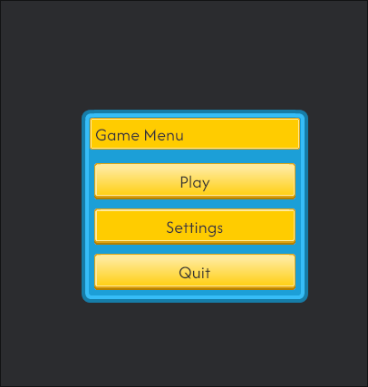
